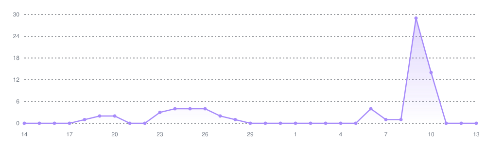
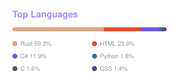

-   :briefcase: **Software Engineer** at **Procter & Gamble**
-   :mortar_board: Computer Science student, **1.0/4.0 GPA**
-   :crab: Rewriting everything in **Rust** (nobody asked)
-   :keyboard: **(Neo)Vim** user, I use **Arch** btw
-   :robot: Building **AI agents** to do my job while I'm at the gym
-   :whale: **Docker** enjoyer, if it's not in a container it doesn't exist
-   :building_construction: Need a todo app? **K8s** + **Redis** + **Kafka** + **Terraform** + 3 microservices

 

